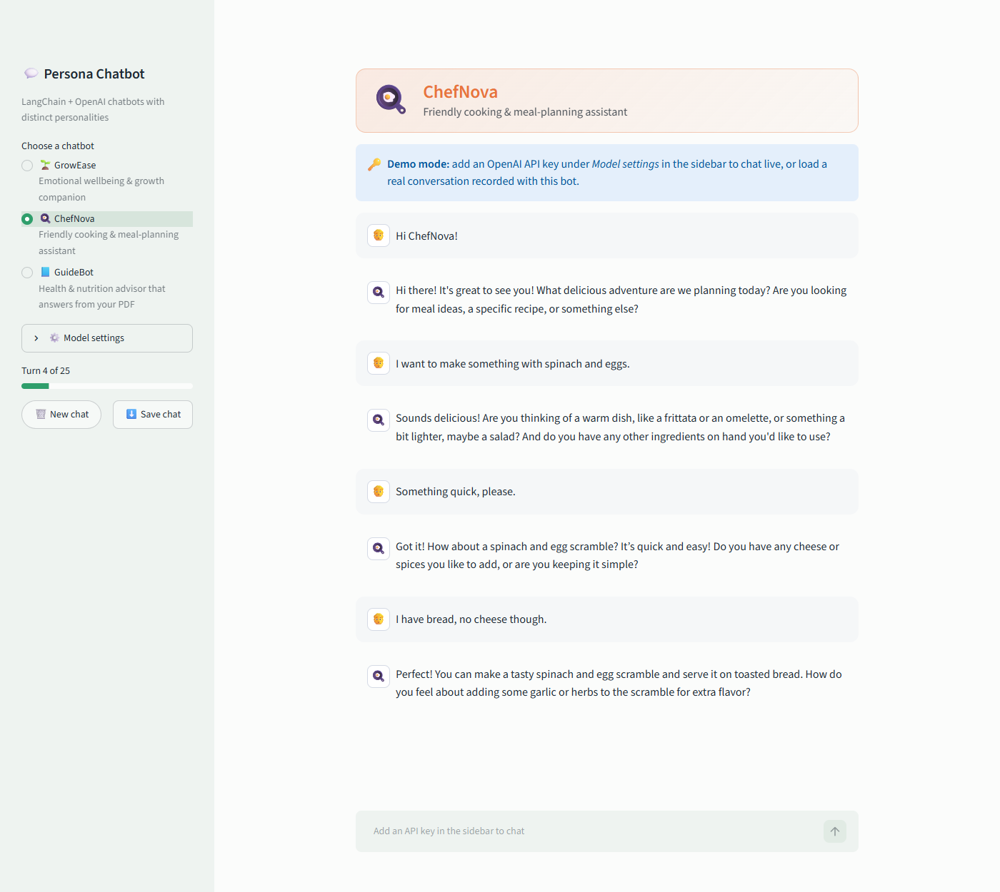
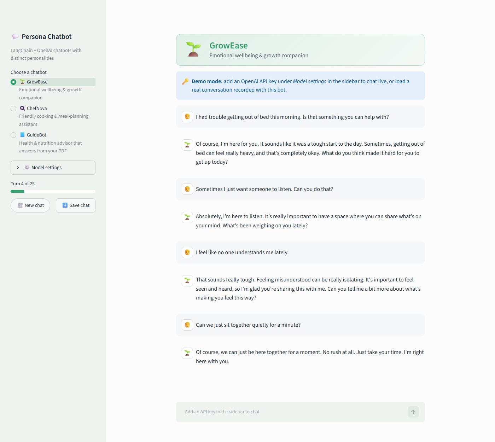
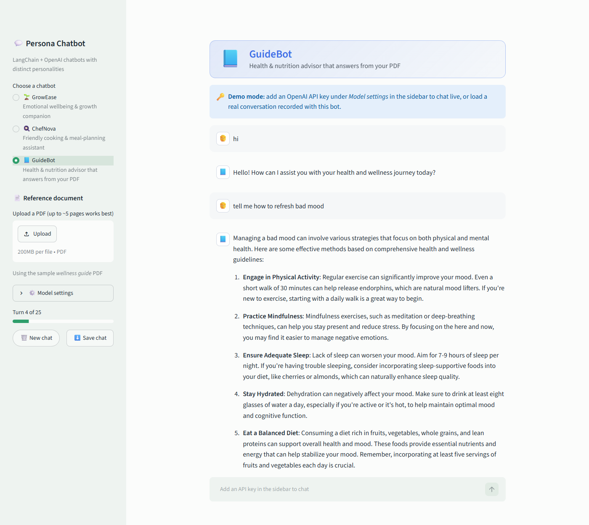
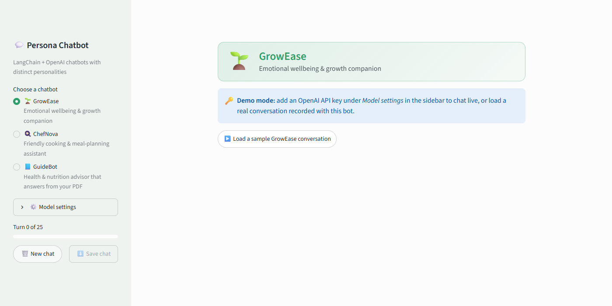

# Persona Chatbot: LangChain + OpenAI

A Streamlit chat app with three LLM chatbots, each with its own personality defined through prompt engineering. One of them answers questions from a PDF you upload. It's built with **LangChain**, **OpenAI** and **Streamlit**.



## The chatbots

| Bot | Role | What makes it interesting |
|-----|------|---------------------------|
| 🌱 **GrowEase** | Emotional wellbeing companion | Empathetic, paced dialogue: mirrors the user's words, offers one coping idea at a time, knows its limits and points to professional help when needed |
| 🍳 **ChefNova** | Cooking & meal-planning assistant | Builds a recipe *with* you through short back-and-forth questions instead of dumping a full recipe, and remembers dietary preferences |
| 📘 **GuideBot** | Health & nutrition advisor | **Document-grounded answers:** reads your PDF and injects it into the prompt as reference material (context augmentation) |

## Features

- **Prompt-engineered personas:** each bot has a structured system prompt covering persona, task, dialogue strategy, limitations and communication style (see [`chatbot/personas.py`](chatbot/personas.py)).
- **Conversation memory:** the last 10 exchanges are sent with every request, so the bot remembers what you told it.
- **PDF context:** upload your own PDF for GuideBot, or use the included sample wellness guide.
- **Streaming replies:** responses appear token by token.
- **Session limit:** a 25-turn progress bar, which the bots are also told about in their prompts.
- **Save chat:** download the conversation as a text file for later analysis.
- **Model settings:** switch between OpenAI models and adjust the temperature.
- **Demo mode:** with no API key, you can still browse real conversations recorded with each bot.

## Screenshots

| GrowEase | GuideBot (answering from the PDF) |
|---|---|
|  |  |



## Getting started

```bash
git clone https://github.com/arslanahmedbhutto/llm-persona-chatbot.git
cd llm-persona-chatbot
pip install -r requirements.txt
```

Add your OpenAI API key, using **one** of these options:

- Copy `.env.example` to `.env` and put your key in it, **or**
- Paste the key into the sidebar under **Model settings** while the app is running.

Then start the app:

```bash
streamlit run app.py
```

> Your `.env` file is listed in `.gitignore`, so your key is never committed. Never hard-code API keys in notebooks or source files.

## Deploying to Streamlit Community Cloud

1. Go to [share.streamlit.io](https://share.streamlit.io) and choose **Create app**.
2. Pick this repository, branch `main`, and main file path `app.py`.
3. Under **Advanced settings**, choose Python **3.11** and add your key in **Secrets**:

   ```toml
   OPENAI_API_KEY = "your-key-here"
   ```

4. Click **Deploy**. Without a key in Secrets, the app runs in demo mode.

## How it works

```
User message
    │
    ▼
System prompt (persona + optional PDF text)  ─┐
Last 10 exchanges (memory)                    ├─►  LangChain ChatOpenAI  ─►  streamed reply
New user message                             ─┘
```

1. `chatbot/personas.py` defines each bot's system prompt and display settings.
2. `chatbot/engine.py` builds the message list (system prompt, memory, new message), extracts PDF text with `pdfplumber`, and streams the reply from OpenAI through LangChain.
3. `app.py` is the Streamlit interface, which keeps a separate chat history for each bot.

## Project structure

```
llm-persona-chatbot/
├── app.py                   # Streamlit chat interface
├── chatbot/
│   ├── personas.py          # Persona system prompts
│   ├── engine.py            # LangChain/OpenAI calls, memory, PDF reading
│   └── demo.py              # Loads recorded conversations for demo mode
├── sample_conversations/    # Real conversations recorded with each bot
├── sample_docs/
│   └── wellness_guide.pdf   # Sample reference document for GuideBot
├── screenshots/
├── .streamlit/config.toml   # Theme
├── .env.example             # Template for your API key
└── requirements.txt
```

## Tech stack

Python · LangChain · OpenAI API (GPT-4o mini by default) · Streamlit · pdfplumber

## Disclaimer

GrowEase and GuideBot are demo projects. They are not medical or mental-health services and don't replace professional advice.
